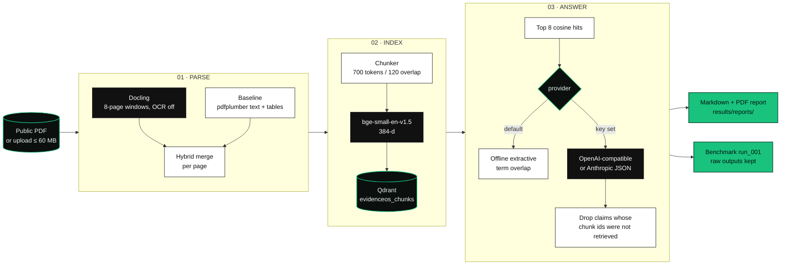
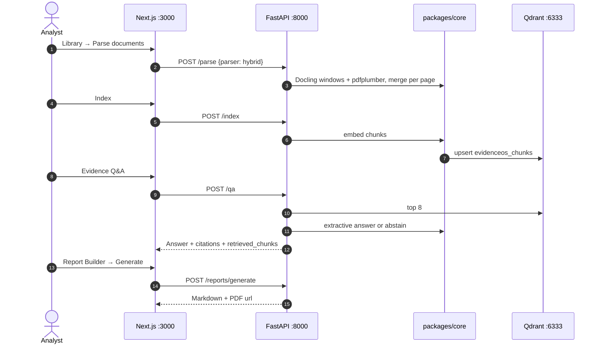

<p align="center">
  Mini-Doc<br>
  <strong>Ask a regulated PDF a question. Cite the page, or abstain.</strong><br>
  <sub>Hybrid parse → token chunks → local bge-small on Qdrant → offline extractive answers → Markdown and PDF report → 30 questions committed before the results.</sub>
</p>

<p align="center">
  
  
  
  
  
  
  
  
  
</p>

No logo or screenshots are committed in this repository. The walkthrough is a script, not a recording. See [The demo](#the-demo).

---


## ▍Project gallery

<table><tr>
<td width="50%"></td>
<td width="50%"></td>
</tr></table>

<sub>Images from the [project portfolio](https://bede-lau.github.io/); they may depict an earlier build.</sub>

## ▍The problem

Regulated document work fails when an answer is fluent and untraceable. An analyst has to ingest messy PDFs, keep section and table structure, tie every fact to a filename and a page, separate a quote from an inference, stop when the corpus does not cover the question, and hand an auditor a report they can re-read.

Mini-Doc is a local demo of that loop on nine public PDFs (MAS, ACRA, three Singapore bank annual reports, two US NFIP flood documents). The default path needs no API key. `Claim` and `Answer` are Pydantic models: a supported answer cannot be constructed without a citation, and an `insufficient_evidence` answer cannot carry claims.

---

## ▍The pipeline at a glance



| Stage | Where | What it decides |
| --- | --- | --- |
| **Ingest** | `scripts/download_public_docs.py`, `POST /ingest` | A PDF lands in `data/raw_docs/`. The registry stores SHA-256, page count, and manifest domain. Uploads are capped at 60 MB. |
| **Parse** | `HybridParser` (default), `BaselineParser`, `DoclingParser` | Docling elements are kept when the page is not weak. A page is weak when Baseline extracted something and Docling extracted nothing, or when Docling has no table, fewer than 40 non-table characters, and less text than Baseline. Baseline tables replace Docling tables when Docling has no table text, or when Baseline's table text is longer than 1.15× Docling's. Docling OCR is off. Both Docling paths convert in 8-page windows. |
| **Chunk** | `packages/core/chunking/chunker.py` | ~700 tokens, ~120 overlap, page and section kept. A table stays one chunk when it fits. Chunks never combine across documents. |
| **Index** | `Embedder`, `QdrantStore` | Local SentenceTransformers vectors plus payload metadata (filename, pages, section, parser, source URL). |
| **Answer** | `packages/core/generation/qa.py` | Offline: abstain when there are no hits, the top cosine score is below 0.35, or no sentence shares terms with the question. Otherwise quote the highest-overlap sentences and cite that chunk. API mode asks for JSON, drops claims whose chunk ids were not retrieved, and falls back to the extractive answer on bad JSON or any exception. |
| **Report** | `reporting/builder.py`, `renderer.py`, `pdf_renderer.py` | Four report types. Each runs four seed questions through the same QA path and writes Markdown and a reportlab PDF. |
| **Benchmark** | `evaluation/benchmark.py` | Deterministic metrics over the fixed 30 questions. Abstentions and misses stay in the raw files. |

`PageElement.bbox` exists on the schema. No parser in this repo assigns it, and the UI does not read it.

### Grounding

| Rule | Enforced by |
| --- | --- |
| A claim needs at least one citation or evidence id | `Claim` validator |
| A `supported` answer needs at least one citation | `Answer` validator |
| An `insufficient_evidence` answer has no claims | `Answer` validator |
| Abstain text is fixed | `"Insufficient evidence in the reviewed documents."` |
| Conflict flag | Schema value `conflicting_evidence`. The offline answerer never emits it. The API path keeps it only when the model JSON says so and at least one claim survives the chunk-id check. |
| Retrieved chunks are stored on every answer | `Answer.retrieved_chunks` |

### Committed `run_001`

Generated `2026-07-05T02:59:44+08:00` on Windows, Python 3.12.10, `llm_provider: offline`, `BAAI/bge-small-en-v1.5`, chunk 700/120, top_k 8, abstention threshold 0.35. Source: [`results/run_001/summary.md`](results/run_001/summary.md), [`run_config.yaml`](results/run_001/run_config.yaml), [`environment.txt`](results/run_001/environment.txt).

| Metric | Value |
| --- | ---: |
| Questions | 30 |
| hit_at_1 | 0.6333 |
| recall_at_3 | 0.7667 |
| recall_at_5 | 0.8 |
| MRR | 0.7069 |
| citation_page_match | 0.7333 |
| abstention_correctness | 0.8333 |
| insufficient_evidence answers | 0 |
| unsupported_claim_total (proxy) | 0 |

`citation_page_match` is document-level on this run. `citation_page_match` checks a page band only when both `expected_page_start` and `expected_page_end` are set. Every page cell in [`benchmark/questions.csv`](benchmark/questions.csv) and [`benchmark/expected_sources.csv`](benchmark/expected_sources.csv) is blank, so a citation to the expected filename scores 1.

`unsupported_claim_total` is a proxy: a claim counts as unsupported when the first 60 normalised characters of `claim_text` do not appear in any retrieved chunk. It is not a judgement that the answer states the right fact.

All 30 answers are `supported`. The five labelled `should_abstain` (Q001–Q005) are why abstention correctness is 0.8333 (25/30). The summary's other `hit_at_1 = 0` rows are Q009, Q019, and Q021–Q024. Raw rows are in [`results/run_001/raw_outputs.jsonl`](results/run_001/raw_outputs.jsonl), [`retrieved_chunks.jsonl`](results/run_001/retrieved_chunks.jsonl), and [`scores.csv`](results/run_001/scores.csv).

Parser audit written with the same run, from `data/parsed/_parse_metrics.jsonl` on that machine (the jsonl is gitignored). `document_count` is the number of metric rows for that parser, which is higher than the nine manifest files:

| Parser | Metric rows | Parse success | Empty-page rate | Seconds / page | Crashes |
| --- | ---: | ---: | ---: | ---: | ---: |
| baseline | 36 | 1.0 | 0.0024 | 0.0761 | 0 |
| docling | 30 | 1.0 | 0.8231 | 0.8764 | 0 |
| hybrid | 39 | 1.0 | 0.0024 | 0.8275 | 0 |

Manual columns in `scores.csv` and `parser_scores.csv` are blank. [`summary.md`](results/run_001/summary.md) still says manual scoring is to be filled. `scripts/apply_manual_scores.py` contains analyst judgements from an earlier `run_001` (summary dated 2026-07-04, before the hybrid result rewrite) and would stamp those numbers onto the current files. It does not re-score the current answers. `results/run_001/manual_scoring.md` is not in the tree.

Question mix, committed in [`benchmark/questions.csv`](benchmark/questions.csv) and unchanged since `5c8e89c`:

| Domain | Questions |
| --- | ---: |
| finance_regulatory | 8 |
| insurance | 6 |
| kyc | 6 |
| financial_table | 5 |
| abstention (all `should_abstain`) | 5 |

History: `5c8e89c` (2026-07-04 03:19 +0800) adds the question set and scoring script. `565cffa` (03:37 +0800) adds the first results. `89839d1` later rewrites `results/run_001` in the same commit as the hybrid parser and PDF reports. The policy in [`benchmark/README.md`](benchmark/README.md) is still: do not edit questions after seeing results; a new set goes in a new directory and a new `results/run_*`. [`examples/demo_script.md`](examples/demo_script.md) tells a presenter to point at commit subjects `test: add fixed benchmark set and scoring script` and `eval: add first reproducible benchmark run`. Those subjects are not in `git log`. The commits above are.

---

<a id="the-demo"></a>

## ▍The demo

Nothing in the repo is a screenshot, Loom, or MP4. [`examples/demo_script.md`](examples/demo_script.md) is a five-minute presenter script. [`examples/sample_compliance_report.md`](examples/sample_compliance_report.md) is hand-authored to show the template. Its header says the figures were not extracted by a live run. A generated report is whatever `POST /reports/generate` writes under `results/reports/` (gitignored).

With Qdrant, parse, and index already done, the app is four pages:

| URL | Page | What you can do |
| --- | --- | --- |
| `http://localhost:3000/` | Document Library | List domain, parser, pages, status, SHA-256. Upload a PDF. Parse, index, or delete. |
| `http://localhost:3000/qa` | Evidence Q&A | Ask a question. See `supported`, `insufficient_evidence`, or `conflicting_evidence`, citation cards, and the raw retrieved chunks. |
| `http://localhost:3000/reports` | Report Builder | Generate one of the four briefs. Download the Markdown or the PDF. |
| `http://localhost:3000/benchmark` | Benchmark | Run a `run_id`, inspect metric tiles, or delete a run. |

The script's two spoken questions, both present as UI suggestions or benchmark items:

1. "Who qualifies as a registrable controller?"
2. "Under the EU General Data Protection Regulation (GDPR), what are the six lawful bases for processing personal data?" — labelled abstain. The committed offline run answered it as `supported` (Q001).



API docs: `http://localhost:8000/docs`. Health: `GET /health`.

---

## ▍Run it

Requirements: Python 3.11 or 3.12 (`.python-version` pins 3.11; `requires-python` is `>=3.11`; [`docs/OPERATIONS.md`](docs/OPERATIONS.md) says to avoid 3.13+ because Docling and torch wheels may be missing), Docker, and Node.js for the Next.js 14.2 app in `apps/web`.

```bash
cp .env.example .env
docker compose up -d qdrant          # qdrant/qdrant:v1.12.4 → :6333 REST, :6334 gRPC
python -m venv .venv
source .venv/bin/activate            # Windows PowerShell: .venv\Scripts\Activate.ps1
pip install -r services/api/requirements.txt
pip install -e .                     # packages.core and services importable
```

```bash
python scripts/download_public_docs.py
python scripts/parse_docs.py --parser hybrid
python scripts/index_docs.py --parser hybrid

# diagnostics, same chunk files, different parser name
python scripts/parse_docs.py --parser baseline
python scripts/parse_docs.py --parser docling
```

The first Docling parse and the first index download model weights into the local cache (`models/` by default, gitignored). `parse_docs.py --parser` accepts `baseline`, `docling`, `hybrid`. `index_docs.py --parser` also accepts `ocr` and `any`. The OCR adapter is optional: `pytesseract` and `pdf2image` are commented out in `services/api/requirements.txt`, and a Tesseract binary has to be on `PATH`. The download script and the OCR parser mention `MANUAL_TASKS.md`; that file is gitignored and is not in the tree.

```bash
uvicorn services.api.main:app --reload          # http://localhost:8000
cd apps/web && npm install && npm run dev       # http://localhost:3000
```

Other web scripts in `apps/web/package.json`: `npm run build`, `npm run start`, `npm run lint`. The frontend reads `NEXT_PUBLIC_API_URL` (see `apps/web/.env.local.example`, default `http://localhost:8000`). CORS allows `localhost:3000`, `127.0.0.1:3000`, and `localhost:3001`.

| URL | What |
| --- | --- |
| `http://localhost:3000/` | Library, Q&A, reports, benchmark |
| `http://localhost:8000/docs` | OpenAPI |
| `http://localhost:8000/health` | `{"status":"ok"}` |
| `http://localhost:6333/collections` | Qdrant is up |

**No key needed.** `Settings.effective_llm_provider` is `offline` when `LLM_PROVIDER=offline`, when `FORCE_OFFLINE=true`, or when `openai` / `anthropic` is selected and `LLM_API_KEY` is empty. The benchmark runner uses that same path.

`Settings` loads uppercase field names (`env_prefix=""`). These are the names it reads:

```bash
TIMEZONE=Asia/Singapore
QDRANT_URL=http://localhost:6333
QDRANT_API_KEY=
QDRANT_COLLECTION=evidenceos_chunks
EMBEDDING_MODEL=BAAI/bge-small-en-v1.5
EMBEDDING_DIM=384
MODEL_CACHE_DIR=
CHUNK_SIZE=700
CHUNK_OVERLAP=120
TOP_K=8
ABSTENTION_THRESHOLD=0.35
LLM_PROVIDER=offline          # offline | openai | anthropic
LLM_MODEL=gpt-4o-mini
LLM_API_KEY=
LLM_BASE_URL=                 # OpenAI-compatible base, for example http://localhost:11434/v1
LLM_TEMPERATURE=0.0
FORCE_OFFLINE=false
REPO_ROOT=
```

`EOS_LOG_LEVEL` is read directly by `packages/core/utils/logging.py` (default `INFO`). `.env.example` prefixes the non-Qdrant keys with `EOS_` (`EOS_LLM_API_KEY`, `EOS_FORCE_OFFLINE`, and the rest). Those prefixed names are not bound. `QDRANT_URL`, `QDRANT_API_KEY`, and `QDRANT_COLLECTION` match the example file and the model. Defaults are enough to run offline if you never set a provider.

Leave `LLM_API_KEY` empty in the repo. A non-default `LLM_BASE_URL` receives the bearer token; the adapter logs a warning when that host is not `openai.com`.

### Corpus

`python scripts/download_public_docs.py` reads [`manifests/public_docs.csv`](manifests/public_docs.csv) (nine rows), checks the `%PDF` magic bytes, and writes `data/raw_docs/_download_report.csv`. Flags: `--only <filename>`, `--force`.

| File | Domain | Type |
| --- | --- | --- |
| `mas-trm-guidelines-2021.pdf` | finance_regulatory | regulatory guideline |
| `mas-notice-sfa04-n02-2025.pdf` | finance_regulatory | regulatory notice |
| `guidelines-to-mas-notice-626-2025.pdf` | finance_regulatory | regulatory guidance |
| `acra-registrable-controllers-guidance-2025.pdf` | kyc | guidance |
| `dbs-annual-report-2025.pdf` | finance | annual report |
| `ocbc-annual-report-2025.pdf` | finance | annual report |
| `uob-annual-report-2025.pdf` | finance | annual report |
| `nfip-claims-manual-june-2025.pdf` | insurance | claims manual |
| `sfip-commentary-june-2025.pdf` | insurance | policy commentary |

The ACRA row is a landing page, not a direct PDF. The manifest says to fetch "Guidance on Register of Controllers for Companies" v2 (16 Jun 2025) and save it as `data/raw_docs/acra-registrable-controllers-guidance-2025.pdf`. `data/raw_docs/`, `data/parsed/`, and `data/chunks/` are gitignored apart from `.gitkeep` files.

### Report and benchmark

```bash
curl -X POST http://localhost:8000/reports/generate \
  -H 'Content-Type: application/json' \
  -d '{"report_type":"general_compliance_intelligence"}'
```

`report_type` is one of `general_compliance_intelligence`, `kyc_beneficial_ownership`, `technology_risk_compliance`, `insurance_claims_review`. The response includes `markdown`, `pdf_path`, and `pdf_url` (`GET /reports/{report_id}/download`). Report ids look like `CIR-…`.

```bash
python scripts/run_benchmark.py --run-id run_001
cat results/run_001/summary.md
```

That command overwrites `results/run_001/` (summary, scores, parser scores, raw outputs, retrieved chunks, environment, run config). Questions stay where they are.

### Tests

`pytest` is not pinned in `services/api/requirements.txt`.

```bash
pip install pytest
pytest -q
```

`tests/` has 46 `test_*` functions: schemas and grounding, chunking, hybrid and Docling parser behaviour, offline and API-path QA, scoring, hashing, Qdrant search shape, report PDF bytes, document delete, benchmark delete. This README does not claim a current pass/fail; there is no CI config in the repo.

---

## ▍Repository map

```text
Mini-Doc/
├── packages/core/
│   ├── parsers/          hybrid (default), baseline, docling, optional ocr
│   ├── chunking/         token, page, section, table
│   ├── retrieval/        SentenceTransformers, Qdrant, retriever
│   ├── generation/       offline extractive + OpenAI-compatible / Anthropic
│   ├── reporting/        seed-prompt builder, Markdown, reportlab PDF
│   ├── evaluation/       pure metrics + benchmark runner
│   ├── schemas/          Pydantic contracts
│   ├── config.py         Settings
│   ├── pipeline.py       parse → persist → chunk, shared by CLI and API
│   └── registry.py       data/registry.json
├── services/api/         FastAPI: documents, qa, reports, benchmarks
├── apps/web/             Next.js: /, /qa, /reports, /benchmark
├── scripts/              download, parse, index, run_benchmark, apply_manual_scores
├── manifests/            public_docs.csv
├── benchmark/            questions, expected answers/sources, scoring_config
├── results/run_001/      committed offline run (reports/ and later runs are gitignored)
├── docs/OPERATIONS.md    local runbook
├── examples/             demo script, hand-authored sample report, technical memo
├── tests/                pytest behaviour suite
├── skills/               checked-in agent skill notes; the app does not import them
├── docker-compose.yml    Qdrant only
├── pyproject.toml        package metadata, pytest/ruff/black config
└── AGENTS.md             module map for people working in the repo
```

| Doc | |
| --- | --- |
| [docs/OPERATIONS.md](docs/OPERATIONS.md) | Install, Qdrant, parse, index, benchmark, smoke checks |
| [benchmark/README.md](benchmark/README.md) | Fixed-set contract and the two-commit rule |
| [examples/demo_script.md](examples/demo_script.md) | Five-minute presenter script |
| [examples/sample_compliance_report.md](examples/sample_compliance_report.md) | Hand-authored report template |
| [examples/technical_memo.md](examples/technical_memo.md) | Build notes. A few lines describe files and scores that the current `results/run_001` no longer contains |
| [AGENTS.md](AGENTS.md) | Import rules, grounding rules, extension points |

There is no Makefile. Data and model weights are produced by the scripts above.

### Not built

Listed because the current code and the older README both name them. None of these are implemented:

- BM25 or a cross-encoder. Retrieval is dense cosine plus optional payload filters. `ReportConfig.reranking` is the string `"none (dense only)"`.
- Drawing `bbox` highlights in the UI.
- Ragas or DeepEval. Both are commented out in `services/api/requirements.txt`. `scoring_config.yaml` lists `faithfulness`, `contextual_relevancy`, and `answer_relevancy` as optional and they are not computed.
- Filling expected page bands after parse.
- Cross-document entity linking.
- An automated table-structure score against an external dataset.

---

## ▍What this is, and isn't

- A local single-user demo. No authentication, no tenancy, no deployment target.
- Public PDFs listed in the manifest, plus whatever you upload. The sample report is hand-written.
- Offline answers are sentences copied from retrieved chunks, chosen by term overlap. They do not recompute a figure or join two passages into a new sentence. The committed run's manual columns are empty for that reason: a human still has to say whether the quoted sentence answered the question.
- Abstention is implemented and unit-tested. On the committed offline run it did not fire: zero `insufficient_evidence` answers, including the five questions labelled to abstain.
- `unsupported_claim_total: 0` means those quotes occur inside the cited chunks. It does not mean the quotes are the right facts.
- On the committed parser audit, Docling's empty-page rate is 0.8231 with OCR disabled. Hybrid's is 0.0024, the same figure as Baseline. The hybrid merger replaces a weak Docling page with the Baseline page.
- Docling's Python API moves between releases. The hybrid path is the one the app and the CLI default to. Re-check a raw Docling diagnostic against the Docling version you have installed (`environment.txt` records `docling==2.109.0` for `run_001`).
- The API LLM path can flag `conflicting_evidence`. The offline path cannot.

---

## ▍Credits

| | |
| --- | --- |
| Layout and tables | [Docling](https://github.com/DS4SD/docling) (OCR off in this repo) and [pdfplumber](https://github.com/jsvine/pdfplumber) |
| Embeddings | [SentenceTransformers](https://www.sbert.net/) · [BAAI/bge-small-en-v1.5](https://huggingface.co/BAAI/bge-small-en-v1.5) |
| Vector store | [Qdrant](https://github.com/qdrant/qdrant) `v1.12.4` |
| API and models | [FastAPI](https://fastapi.tiangolo.com/), [Pydantic](https://docs.pydantic.dev/) v2 |
| UI | [Next.js](https://nextjs.org/) 14.2, React 18, Tailwind 3 |
| PDF reports | [reportlab](https://www.reportlab.com/) |
| Token counts | [tiktoken](https://github.com/openai/tiktoken) `cl100k_base`, with a 4-character heuristic if the import fails |
| HTTP | [httpx](https://www.python-httpx.org/) for the optional LLM calls |
| Corpus | URLs in [`manifests/public_docs.csv`](manifests/public_docs.csv): MAS, ACRA, DBS, OCBC, UOB, FEMA NFIP. Those PDFs are not vendored. |

`pyproject.toml` declares MIT. There is no separate `LICENSE` file in the tree. The web footer and the sample report both say the same thing: public demo data only, not legal, financial, insurance, or regulatory advice.

<p align="center">
  <sub>Local Qdrant, local embeddings, offline answers. A key is only for a provider you turn on yourself.</sub>
</p>
